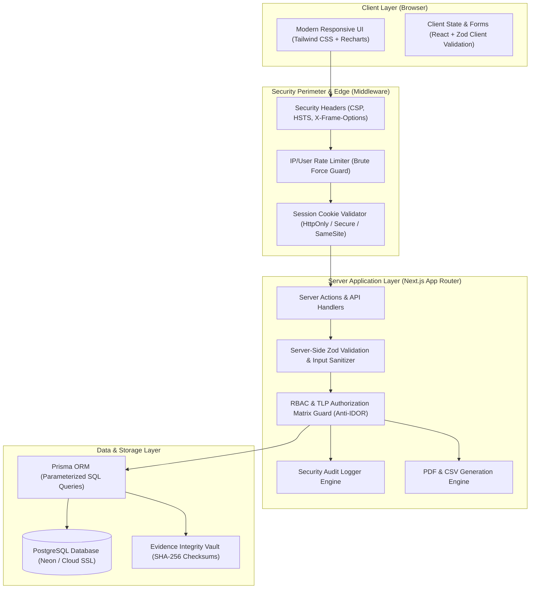
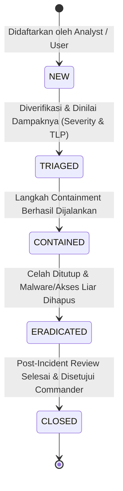

# ARCHITECTURE & THREAT MODELING: AegisSOC

Dokumen ini mendefinisikan arsitektur teknis, diagram aliran data (*Data Flow Diagram*), dan analisis pemodelan ancaman (*STRIDE Threat Model*) untuk sistem **AegisSOC**.

---

## 1. Diagram Arsitektur Sistem

Arsitektur AegisSOC dibangun dengan pendekatan **Security-by-Design** dan **Separation of Concerns**:

---

## 2. Alur Penanganan Insiden (Incident Handling State Machine)
Sesuai standar **NIST SP 800-61 Rev. 2**, siklus hidup setiap insiden diatur sebagai berikut:

---

## 3. STRIDE Threat Model & Mitigasi Keamanan

Pemodelan ancaman dilakukan untuk mengidentifikasi potensi risiko terhadap aplikasi AegisSOC dan menetapkan mitigasi teknis sebelum implementasi kode.

| Vektor Ancaman (STRIDE) | Deskripsi Risiko pada AegisSOC | Dampak Potensial | Mitigasi Teknis yang Diterapkan |
|---|---|---|---|
| **S - Spoofing** (Pemalsuan Identitas) | Penyerang memalsukan identitas pengguna atau menebak password akun Commander. | Akses tidak sah ke kasus insiden rahasia. | 1. Hashing password menggunakan `bcrypt` (*salt rounds* 12). 2. Sesi berbasis cookie `HttpOnly`, `Secure`, dan `SameSite=Lax`. 3. *Rate limiting* pada endpoint login (maksimal 5 kegagalan per 5 menit). |
| **T - Tampering** (Manipulasi Data) | Penyerang memanipulasi bukti digital, catatan forensik, atau menyuntikkan payload SQL. | Bukti forensik tidak sah (*compromised chain of custody*), integritas database rusak. | 1. Perhitungan *cryptographic checksum* (SHA-256) pada setiap bukti artefak. 2. Seluruh query database wajib menggunakan parameterized queries via Prisma ORM. 3. Tabel `AuditLog` bersifat *append-only* (tidak ada fitur update/delete). |
| **R - Repudiation** (Penyangkalan Aksi) | Pengguna menyangkal telah menghapus kasus insiden atau mengubah status penanganan. | Hilangnya akuntabilitas dalam investigasi forensik. | Setiap mutasi data krusial dicatat secara otomatis ke dalam `AuditLog` mencakup: `userId`, `action`, `resourceId`, `ipAddress`, `userAgent`, dan `timestamp`. |
| **I - Information Disclosure** (Kebocoran Data) | Pengguna dengan peran `ANALYST` membuka data kasus bertanda `TLP:RED` melalui manipulasi ID pada URL (IDOR). | Bocornya insiden siber berkategori sangat rahasia ke pihak yang tidak berhak. | 1. Penegakan matriks otorisasi TLP di tingkat *server-side* pada setiap *query request*. 2. Verifikasi kepemilikan dan hak akses sebelum mengembalikan data. 3. Tidak ada data sensitif yang di-render di client jika otorisasi gagal (HTTP 403 Forbidden). |
| **D - Denial of Service** (Penolakan Layanan) | Penyerang melakukan *flooding* request pendaftaran insiden atau percobaan login massal (*brute force*). | Server mengalami kelangkaan sumber daya, pengguna sah tidak dapat login. | 1. *Sliding-window rate limiting* pada endpoint otentikasi dan pembuatan data. 2. Pembatasan ukuran muatan request (*request body limit*). 3. Validasi skema Zod menolak request tidak valid secara dini tanpa membebani database. |
| **E - Elevation of Privilege** (Eskalasi Hak Akses) | Pengguna biasa memodifikasi payload form registrasi/profil untuk mengubah peran menjadi `COMMANDER`. | Pengambilalihan kendali sistem secara penuh. | 1. Peran `role` tidak dapat diset sembarangan dari payload registrasi publik (default ke `ANALYST`). 2. Pengangkatan peran hanya dapat dilakukan oleh `COMMANDER` melalui sesi terverifikasi. |

---

## 4. Matriks Otorisasi Berbasis Traffic Light Protocol (TLP 2.0)

Aturan isolasi akses data kasus insiden diimplementasikan sebagai berikut:

| Klasifikasi TLP | Hak Akses `COMMANDER` | Hak Akses `RESPONDER` | Hak Akses `ANALYST` |
|---|---|---|---|
| **TLP:RED** (*Strictly Confidential*) | Baca, Ubah, Hapus, Ekspor | Baca & Ubah (Hanya jika ditugaskan sebagai *Assignee*) | ❌ **DIBLOKIR** (HTTP 403 & Tercatat di Audit Log) |
| **TLP:AMBER** (*Restricted to SOC Team*) | Baca, Ubah, Hapus, Ekspor | Baca & Ubah | ❌ **DIBLOKIR** (Hanya tim investigasi internal) |
| **TLP:GREEN** (*Community/Organization Wide*) | Penuh | Penuh | Baca & Laporkan Temuan Baru |
| **TLP:WHITE / CLEAR** (*Publicly Disclosable*) | Penuh | Penuh | Penuh (Baca & Buat Tiket) |

